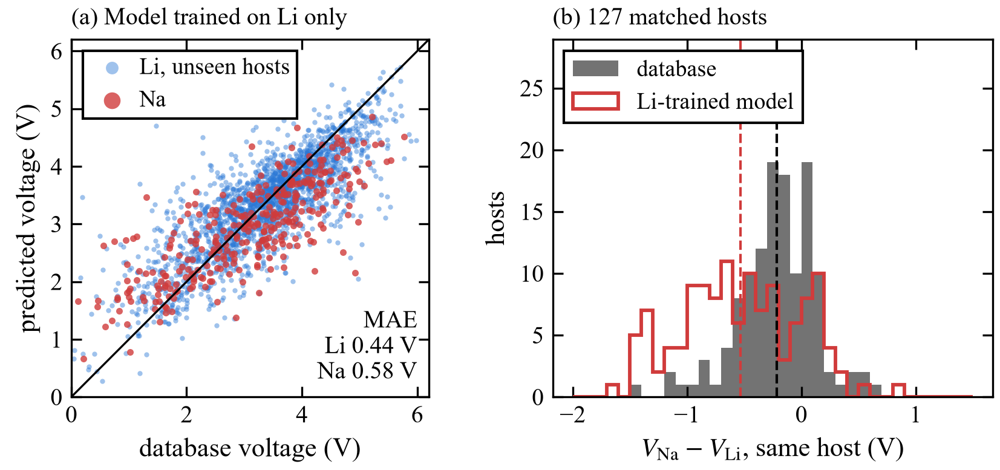
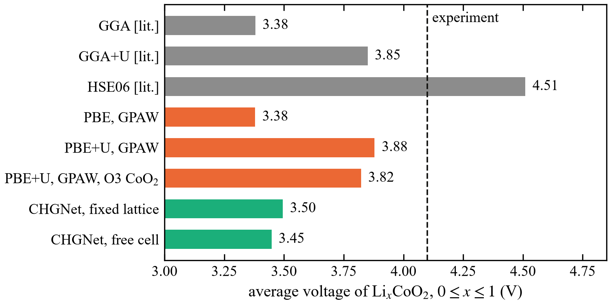
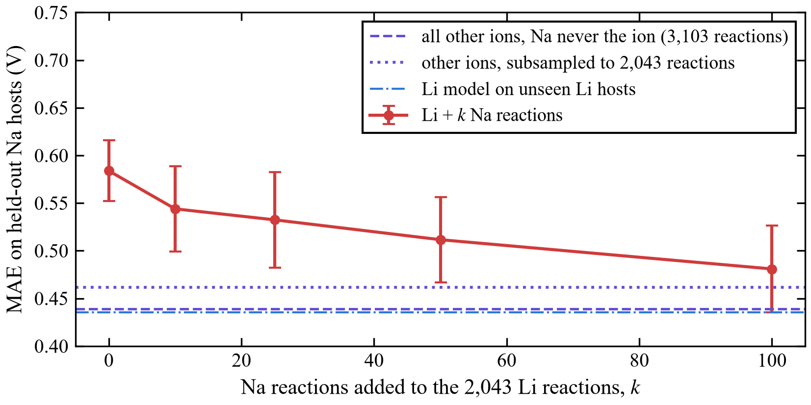
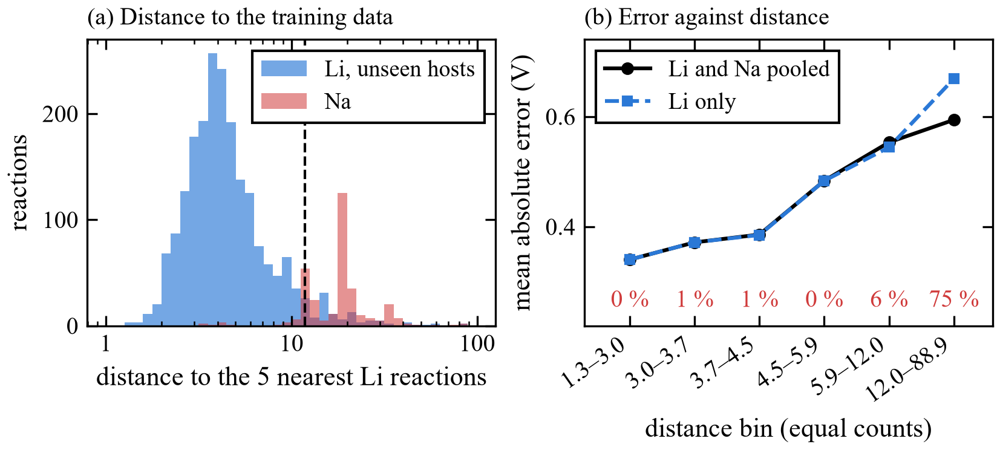
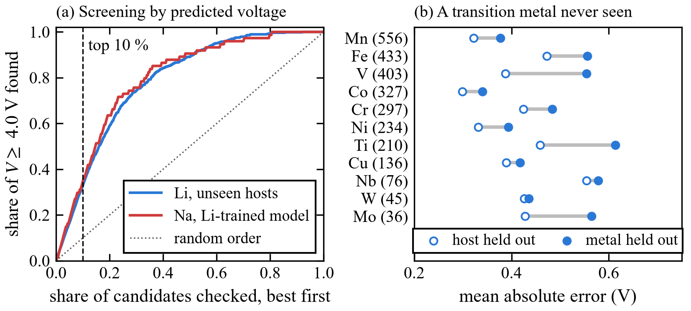
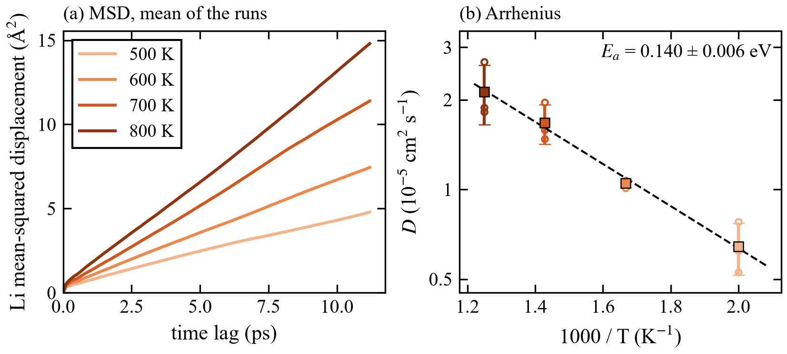

# Intercalation-Voltage

[](https://github.com/Shuruyue/Intercalation-Voltage/actions/workflows/ci.yml)


**[Interactive page](https://shuruyue.github.io/Intercalation-Voltage/web/intercalation-voltage.html)**: type the discharged and charged compositions of an insertion electrode and get the average voltage that a gradient-boosting model trained on 2,043 lithium reactions of the Materials Project predicts, with a warning light for compositions unlike its training data. On lithium host systems it has not seen, its mean error is 0.44 V; on the 327 sodium reactions it is 0.58 V, and for the 127 hosts that appear with both ions it puts the sodium version 0.53 V below the lithium one, where the database says 0.21 V.

[](https://shuruyue.github.io/Intercalation-Voltage/web/intercalation-voltage.html)

*(a) Voltage predicted by a gradient-boosting model trained on lithium reactions only, against the database voltage: lithium reactions of host systems held out of training (blue, 5-fold group split) and every sodium reaction (red). (b) For the 127 hosts with both a lithium and a sodium reaction, the sodium voltage minus the lithium voltage in the database (grey) and with the sodium voltage predicted by the lithium-trained model (red); dashed lines: the means.*

## Electrode Voltage from Physics and from Data

The voltage of an insertion electrode is set by how strongly the solid holds the working ion: averaged over a reaction step, it is a difference of total energies, which density-functional theory (DFT) computes and which a model can learn from a database of such calculations. This project does both for the same quantity and asks where each can be trusted. It computes the voltage of LiCoO<sub>2</sub> with DFT (GPAW) and with the machine-learned potential CHGNet, uses CHGNet molecular dynamics for lithium diffusion in α-Li<sub>3</sub>N, and trains gradient boosting on the lithium electrodes of the Materials Project, then tests it on lithium host systems it has not seen and on sodium, a working ion it has never seen. Finally it asks what this is worth for finding a material: how well a ranking by the model picks out high-voltage electrodes, and how the model fares on a transition metal it has never seen.

Every number below is computed by `intercalation_voltage/summary.py` from `results/*.json` and the outputs in `calc/`, and `scripts/validate.py` checks that this README still quotes what the results give. Voltages are average voltages against the metal of the working ion over a whole reaction step.

## Project Overview

### Core Features

- **DFT** — GPAW (projector augmented waves, plane waves) with PBE and PBE+U for LiCoO<sub>2</sub>, CoO<sub>2</sub> in O1 and O3 stacking, and lithium metal at experimental lattices; checked for cutoff and k-point convergence and against published values.
- **Machine-learned potential** — CHGNet voltages of LiCoO<sub>2</sub> and NaCoO<sub>2</sub> with free and with fixed cells; 12 molecular-dynamics runs of α-Li<sub>3</sub>N (106 atoms, 25 ps each) at 500–800 K, giving D(T) and an activation energy.
- **Data** — the Materials Project insertion-electrode snapshot of 2019-12-03, cleaned to 3,430 reaction steps of 10 working ions; 266 Magpie composition features per reaction.
- **Machine learning** — gradient boosting tested on held-out host systems against a random split, from lithium to sodium, from all other ions to sodium, on 127 matched hosts, with a learning curve that has a training-set-size control, with one transition metal held out at a time, and as the first filter of a screen for high-voltage electrodes.
- **Warning light** — the distance of a reaction to its nearest training reactions, with a threshold set on unseen lithium hosts; the model, the features and the light run unchanged in the browser.
- **Validation** — automated checks (see [VALIDATION.md](VALIDATION.md)), unit tests, and the page's JavaScript checked against Python case by case, run in CI on every push.

## Quick Start

### Installation

```bash
git clone https://github.com/Shuruyue/Intercalation-Voltage.git
cd Intercalation-Voltage
pip install -r requirements-lock.txt   # the exact versions behind the results
pip install -e ".[dev]"                # add ",md" for CHGNet; GPAW needs Linux or WSL: environment-dft.yml
python scripts/prep_data.py            # clean the snapshot, build data/features.npz (< 1 min)
```

### Usage

```bash
python scripts/summary.py        # the numbers of this README, computed from results/ and calc/
python scripts/make_figures.py   # all figures → docs/figures/
```

```python
from intercalation_voltage import features, learning

model = learning.fit_li()                              # the lithium-only model of the page (about 15 s)
x = features.reaction_vector("NaCoO2", "CoO2", "Na")   # discharged, charged, working ion
print(round(model.predict([x])[0], 2))                 # 2.64; the database says 2.54 V
```

### Validation Scripts

```bash
pytest -q                               # unit tests and the page's data against the results
node tests/web_model.test.js            # the page's JavaScript against Python, 313 reactions
python scripts/validate.py --markdown   # checks on results/ and calc/ → VALIDATION.md
```

`scripts/validate.py` exits with code 1 if any check fails. The full table is in [VALIDATION.md](VALIDATION.md).

### Reproducing the results

Run from the repository root. Times are for one desktop (Intel Core i5-13400, NVIDIA RTX 3060).

| Step | Command | Time |
|---|---|---|
| Cleaning and features | `python scripts/prep_data.py` | < 1 min |
| Machine-learning experiments, the distance check and the screening | `python scripts/run_ml.py` | ~25 min, one core |
| Model and check cases for the page, the page | `python scripts/export_web_model.py`, `python scripts/build_web_page.py` | ~1 min |
| DFT, 11 runs (Linux or WSL, `environment-dft.yml`) | in `calc/dft/output`: `python ../dft_voltage.py <tag> <U> [650 2]` | 0.04–5.2 min each with 4 threads |
| CHGNet voltages | `python calc/chgnet/chgnet_voltage.py` | ~3 min on the CPU |
| CHGNet molecular dynamics, one 25 ps run | `python calc/md/md_li3n.py <T> --seed <n> --out calc/md/runs/<T>K_seed<n>` | ~20 min on the GPU |
| Diffusion coefficients and Arrhenius fit | `python scripts/analyze_md.py` | ~1 min |
| Cost of one energy evaluation | `python calc/timing/timing.py dft` (Linux), `python calc/timing/timing.py chgnet` | ~14 min |
| Figures, validation table | `python scripts/make_figures.py`, `python scripts/validate.py --markdown` | seconds |

The MD trajectories (9 MB each) are not in the repository; `calc/md/runs/*/analysis.json` holds what `scripts/analyze_md.py` takes from them.

## Project Structure

```text
Intercalation-Voltage/
├── intercalation_voltage/
│   ├── features.py        # Magpie features of a reaction, ion terms, host keys
│   ├── data.py            # cleaning of the Materials Project snapshot
│   ├── learning.py        # gradient-boosting experiments
│   ├── distance.py        # the warning light: distance to the training data
│   ├── screening.py       # the model as a first filter; one transition metal held out
│   ├── web_model.py       # the model and check cases for the page
│   ├── structures.py      # starting structures (pymatgen)
│   ├── voltage.py         # voltage from total energies; DFT and CHGNet results
│   ├── diffusion.py       # MSD, D and Arrhenius fits from MD trajectories
│   ├── summary.py         # every number quoted in this README (compute)
│   ├── validation.py      # checks behind VALIDATION.md (run_all)
│   └── plotting.py        # figures (14 cm wide, 300 dpi)
├── calc/
│   ├── dft/               # GPAW script; output/ (this work) and first_run/ (an earlier run, see Validation)
│   ├── chgnet/            # CHGNet voltages
│   ├── md/                # CHGNet molecular dynamics; runs/<T>K_<run>/ with run.json and analysis.json
│   └── timing/            # cost of one energy evaluation
├── data/                  # the snapshot and the cleaned table
├── scripts/               # command-line entry points (see Reproducing the results)
├── tests/                 # pytest, and the Node test of the page
├── results/               # output of the scripts
├── docs/figures/          # figures of this README
├── web/                   # interactive page (GitHub Pages); web/src holds its sources
└── VALIDATION.md          # check-by-check validation table
```

## Theoretical Background

### Voltage from total energies

When $x_2 - x_1$ lithium move from the metal into a host between compositions $`\mathrm{Li}_{x_1}\mathrm{H}`$ and $`\mathrm{Li}_{x_2}\mathrm{H}`$, the average voltage is the reaction free energy per transferred electron (Aydinol et al. 1997):

```math
\bar V = -\frac{G(\mathrm{Li}_{x_2}\mathrm{H}) - G(\mathrm{Li}_{x_1}\mathrm{H}) - (x_2-x_1)\,G(\mathrm{Li})}{(x_2-x_1)\,e}
\;\approx\; -\frac{E(\mathrm{Li}_{x_2}\mathrm{H}) - E(\mathrm{Li}_{x_1}\mathrm{H}) - (x_2-x_1)\,E(\mathrm{Li})}{(x_2-x_1)\,e}
```

For solids the $p\Delta V$ term is of order $10^{-6}$ eV per lithium and the entropy terms are small against the errors of the functional, so total energies at 0 K replace the free energies. Over the whole range of LiCoO<sub>2</sub>, $`e\bar V = E(\mathrm{CoO_2}) + E(\mathrm{Li}) - E(\mathrm{LiCoO_2})`$ per formula unit.

### DFT+U

Semi-local functionals spread the localized Co 3d electrons too thin, which places their levels too high and makes the voltage of transition-metal oxides too low. The rotationally invariant correction of Dudarev et al. (1998) penalizes fractional occupation of the d orbitals,

```math
E_{\mathrm{DFT}+U} = E_{\mathrm{DFT}} + \frac{U_\mathrm{eff}}{2}\sum_\sigma \mathrm{Tr}\left[\rho^\sigma - \rho^\sigma\rho^\sigma\right],
```

with $`U_\mathrm{eff}`$(Co) = 3.32 eV, the value the Materials Project fitted to experimental oxidation energies (Wang et al. 2006; Jain et al. 2011), so the DFT of this project and the labels of the database use the same approximation.

### Features and gradient boosting

A reaction is described by its discharged and charged compositions. For each, the Magpie statistics (Ward et al. 2016) of 22 element properties are computed over the elements weighted by their atomic fractions $w_i$: minimum, maximum, range, mean $`\bar p = \sum_i w_i p_i`$, mean absolute deviation $`\sum_i w_i |p_i - \bar p|`$ and the value of the most abundant element. Two terms describe the working ion A: the amount inserted per atom of the discharged composition, $`(n_\mathrm{A}^\mathrm{dis} - n_\mathrm{A}^\mathrm{chg}\,h^\mathrm{dis}/h^\mathrm{chg})/N^\mathrm{dis}`$ with $h$ the number of host atoms and $N$ all atoms, and the atomic fraction of A in the discharged composition. 132 + 132 + 2 = 266 features.

Gradient boosting (Friedman 2001) adds shallow regression trees one at a time, each fitted to the residuals of the sum so far, $`F_m = F_{m-1} + \nu\,h_m`$ with learning rate $\nu$. Each tree is constant over each region of feature space it cuts out, so beyond the training data the model stops following any trend: trained on $y = 2x$ for $0 \le x \le 1$, it predicts 2.0 at $x = 2$. The leaves hold averages of residuals, not of labels, so the sum is not strictly confined to the range of the labels: over the snapshot the lithium model runs from −0.10 V (Ti<sub>3</sub>AlC<sub>2</sub> → Ti<sub>3</sub>C<sub>2</sub> with Al as the working ion) to 5.76 V, against labels of 0.04–5.98 V.

### Validation splits and the distance to the training data

A random split puts reactions of the same host system on both sides; the group split holds out whole host systems (the elements other than the working ion, e.g. Co–O), so every test reaction has a host the model has not seen (Meredig et al. 2018). The distance of a reaction is the mean Euclidean distance to its $k = 5$ nearest lithium training reactions after each feature is standardized with the mean and standard deviation of the lithium data; the threshold is the 95th percentile of the same distance for lithium reactions of held-out host systems, measured against their own training folds.

A stricter split holds out every reaction that contains one transition metal, so the test reactions bring an element the model has never seen. A screen ranks the candidates by their predicted voltage and keeps the best: its precision is the share of the kept candidates that reach the target voltage, its recall the share of all candidates reaching it that are kept, and its enrichment the precision divided by the share in the whole pool.

### Diffusion from molecular dynamics

The mean-squared displacement of the lithium atoms, averaged over atoms and time origins, grows linearly in the diffusive regime:

```math
\mathrm{MSD}(t) = \left\langle |\mathbf r_i(t_0+t) - \mathbf r_i(t_0)|^2 \right\rangle = 6Dt,\qquad
D_{ab} = \frac{\mathrm{MSD}_{xy}}{4t},\qquad D_c = \frac{\mathrm{MSD}_z}{2t},\qquad D = D_0\,e^{-E_a/k_BT}
```

Positions are unwrapped across the periodic boundaries; D is the slope of a straight line through the MSD from 1 ps to half the analysed trajectory, after 2.5 ps of equilibration.

## Parameters

| Parameter | Value | Source |
|---|---|---|
| DFT code | GPAW 26.7.0, PAW setups of gpaw-data 1.0.1 | [8] |
| Functional | PBE; PBE+U with $`U_\mathrm{eff}`$ = 3.32 eV on Co 3d (Dudarev form) | [2, 9, 19] |
| Plane-wave cutoff, k meshes | 520 eV; Γ-centred LiCoO<sub>2</sub> and O3 CoO<sub>2</sub> 7×7×7, O1 CoO<sub>2</sub> 9×9×6, Li 12×12×12; check: 650 eV with 2 (4) more points per direction | this study |
| Lattices, kept fixed | LiCoO<sub>2</sub> R-3m, a = 2.8156 Å, c = 14.0542 Å; O1 CoO<sub>2</sub> P-3m1, a = 2.822 Å, c = 4.29 Å; bcc Li, a = 3.51 Å | [12, 13] |
| Relaxation, smearing | atomic positions by BFGS to 0.03 eV/Å; Fermi–Dirac 0.05 eV (Li metal 0.1 eV); CoO<sub>2</sub> spin-polarized | this study |
| CHGNet | 0.4.2 with the pretrained model 0.3.0; relaxations to 0.02 eV/Å | [14] |
| MD system | α-Li<sub>3</sub>N, P6/mmm, a = 3.648 Å, c = 3.875 Å, 3×3×3 supercell with 2 Li removed from the Li<sub>2</sub>N plane (106 atoms) | [15] |
| MD settings | NVT, Berendsen thermostat (τ = 200 fs, centre-of-mass momentum fixed), 2 fs step, 25 ps per run, frames every 20 fs, first 2.5 ps discarded | this study |
| Data | Materials Project battery explorer, snapshot of 2019-12-03, 5,133 reaction steps | [1, 3] |
| Cleaning | 0 < V ≤ 6 V; both end members at most 0.2 eV/atom above the convex hull; polymorphs with the same compositions merged by their median voltage | this study |
| Model | scikit-learn GradientBoostingRegressor: 400 trees, depth 4, learning rate 0.05, subsample 0.8, squared error, seed 0 | [6, 7] |
| Warning light | k = 5, 238 standardized features (28 are constant over the lithium data), threshold 11.8 | this study |

## Key Results

### LiCoO<sub>2</sub> from first principles

| Method | Average voltage, 0 ≤ x ≤ 1 (V) |
|---|---|
| PBE, this work (GPAW) | 3.379 |
| PBE+U, this work | 3.879 |
| PBE+U with O3 instead of O1 CoO<sub>2</sub> | 3.823 |
| PBE / PBE+U at 650 eV with denser k meshes | 3.367 / 3.866 |
| GGA, GGA+U, HSE06 (Seo et al. 2015) | 3.38, 3.85, 4.51 |
| CHGNet, fixed experimental lattices | 3.50 |
| CHGNet, free cells | 3.45 |
| Experiment | about 4.1 |

**The functional matters far more than the numerics.** Raising the cutoff to 650 eV and refining the k meshes changes the voltage by at most 14 mV, whereas adding U moves it by half a volt, and PBE+U still falls short of experiment. Both of our values agree with the published ones within 0.03 V. The relaxed structure has its O planes 1.04 Å from the Co plane and 1.30 Å from the Li plane (experiment: 1.02 and 1.32 Å).



*Average voltage of Li<sub>x</sub>CoO<sub>2</sub> over 0 ≤ x ≤ 1 by method: literature (grey; Seo et al. 2015), our GPAW calculations (orange) and CHGNet (green). Dashed: experiment.*

**A machine-learned potential inherits more than the energies of its training data.** Trained on PBE(+U) without van der Waals binding, CHGNet lets layered CoO<sub>2</sub> swell along c when its cell is free (O1: 64 % in volume), which moves the lithium voltage from 3.50 V with fixed lattices to 3.45 V. NaCoO<sub>2</sub> has two minima in CHGNet: from the experimental structure it relaxes to Co–O = 1.97 Å, while a start with Na and Co exchanged ends at Co–O = 2.04 Å, 78 meV per formula unit lower, and moves the sodium voltage from 2.71 V to 2.79 V (2.74 V with fixed lattices). The experimental low-spin Co<sup>3+</sup> structure has the short bonds.

### Learning the voltage from the database

Of the 5,133 reaction steps of the snapshot, 4,965 have 0 < V ≤ 6 V, 4,297 of those have both end members within 0.2 eV/atom of the convex hull, and merging polymorphs leaves 3,430 reactions: 2,043 with lithium in 489 host systems and 327 with sodium in 146.

| Test | Mean absolute error (V) |
|---|---|
| Lithium, unseen host systems (5-fold group split) | 0.44 (R² = 0.66) |
| Lithium, random 5-fold split | 0.40 |
| Lithium, always the training mean | 0.82 |
| Sodium, trained on lithium only | 0.58 (R² = 0.60; mean error −0.16 V) |
| Sodium, always the lithium training mean | 0.96 |
| Sodium, trained on every other ion (3,103 reactions, sodium never the working ion) | 0.45 |

The feature the lithium model relies on most is the mean covalent radius of the discharged composition (`discharged: mean CovalentRadius`). Errors above 1 V rise from 9 % of the unseen lithium hosts to 17 % of the sodium reactions. For unseen lithium hosts half of the predictions are within 0.32 V of the database, 48 % within 0.3 V, 67 % within 0.5 V and 91 % within 1 V; for sodium the median error is 0.46 V, with 34 %, 54 % and 83 % within the same limits. **The lithium-trained model learns the wrong sodium shift.** For the 127 hosts that appear with both ions, sodium is 0.21 V lower in the database on average (lower for 71 % of them), but the model puts it 0.53 V lower; measured from the model's own lithium predictions instead of the database values the shift is −0.50 V, and −0.42 V with out-of-fold lithium predictions. Within the lithium data the working ion never changes, so the model has no way to learn what changing it does.



*Mean absolute error on held-out sodium host systems (40 % of them, 10 random splits; mean ± standard deviation) when k sodium reactions from the other sodium hosts are added to the lithium training data, and on the same held-out sets for a model trained on all other ions and for one trained on a random subset of them as large as the lithium set.*

**Other ions help, and not only because there are more of them.** On held-out sodium hosts the error falls from 0.58 V to 0.48 V when 100 sodium reactions are added to the lithium data. A model trained on all other ions, none of them with sodium as the working ion, reaches 0.44 V; cut to the 2,043 reactions of the lithium set, it still reaches 0.46 V.

### The warning light



*(a) Distance of each reaction to its 5 nearest lithium training reactions: lithium reactions of held-out hosts (to their own training folds) and sodium reactions (to all lithium reactions). Dashed: the threshold. (b) Mean absolute error in six distance bins of equal count, for lithium and sodium pooled and for lithium alone; red numbers: the share of sodium in each bin.*

92 % of the sodium reactions lie beyond the threshold that 5 % of the unseen lithium hosts exceed by construction. Among unseen lithium hosts, those beyond it have a mean error of 0.67 V against 0.42 V (Spearman ρ between distance and error +0.18). Within sodium the distance does not rank the errors (ρ = −0.17; 0.57 V beyond the threshold, 0.61 V within it): the light tells that a composition is new to the model, not how wrong the number is, and the rise of the pooled error with distance in (b) comes partly from the growing share of sodium.

### Using the model to find materials



*(a) Share of the reactions with a database voltage of at least 4.0 V that a screen finds, against the share of candidates it checks in the order of the model's prediction: lithium reactions of host systems held out of training (out-of-fold predictions of the group split) and sodium reactions with the lithium-trained model; dotted: a random order. (b) Mean absolute error on the lithium reactions that contain each transition metal, with their host system held out (open) and with every reaction of that metal held out of training (filled); in brackets: the number of reactions.*

A search for a new electrode is a funnel: many candidate compositions, a fast filter, slower and more reliable checks (CHGNet, then DFT) on what survives, and experiments last. Used as the first filter on the 2,043 lithium reactions of unseen host systems, the model does that job and no more. 28 % of the candidates (568) reach 4.0 V in the database; of the 204 it ranks highest (the top 10 %), 91 % do, 3.3 times the base rate, but they hold only 33 % of all such reactions. Keeping every candidate predicted at 4.0 V or more finds 62 % of them at a precision of 80 %. On sodium with the lithium-trained model, 79 % of the top 10 % reach 4.0 V (base rate 23 %) and hold 35 % of such reactions. **The ranking spares most of the slow checks; it does not find every good material,** and the voltage is only one requirement next to stability, capacity, ion transport and cycle life, which this model does not predict.

**A host system the model has not seen is not yet a chemistry it has not seen.** The group split holds out a chemical system such as Co–O, while related systems such as Co–Ni–O stay in training. Holding out every reaction that contains one transition metal, for each of the 11 metals that appear in at least 30 lithium reactions in turn, raises the error on those reactions from 0.39 V to 0.47 V (2,753 reaction–metal pairs; a reaction with two of the metals counts once for each). The largest errors are for Ti 0.61 V, Nb 0.58 V, Mo 0.56 V.

### Lithium diffusion in α-Li<sub>3</sub>N



*(a) Mean-squared displacement of Li at each temperature, mean of the runs. (b) D of each run (open circles), their mean ± standard deviation (squares) and the Arrhenius fit of the means (dashed).*

| T (K) | Runs | D, mean ± standard deviation (cm² s⁻¹) |
|---|---|---|
| 500 | 3 | 6.4 × 10⁻⁶ ± 1.3 × 10⁻⁶ |
| 600 | 3 | 1.0 × 10⁻⁵ ± 3.4 × 10⁻⁷ |
| 700 | 3 | 1.7 × 10⁻⁵ ± 2.5 × 10⁻⁶ |
| 800 | 3 | 2.1 × 10⁻⁵ ± 4.8 × 10⁻⁶ |

With three 25 ps runs at each temperature, D rises from 6.4 × 10⁻⁶ cm² s⁻¹ at 500 K to 2.1 × 10⁻⁵ cm² s⁻¹ at 800 K, and the Arrhenius fit of the means gives $E_a$ = 0.140 ± 0.006 eV (0.140 ± 0.013 eV fitted to every run). The seven runs of a first set alone gave 0.128 ± 0.018 eV. The cell holds two vacancies from the start, so this is mostly the barrier of the vacancy hop; the measured activation energy of in-plane conduction, 0.25 eV (von Alpen et al. 1977), also contains the cost of creating the carriers, and universal potentials tend to soften the potential-energy surface and with it the barriers (Deng et al. 2025). Diffusion within the Li<sub>2</sub>N layers is only 1.8 times faster than along c at 800 K, much less anisotropic than the one to two decades measured for the conductivity.

### What each answer costs

On one thread of the same desktop, one GPAW energy of LiCoO<sub>2</sub> takes 18 s for the 4-atom cell and 300 s for 48 atoms; CHGNet takes 0.97 s for the 48 atoms, 310 times less, and grows about linearly with the cell. The gradient-boosting model needs 2.3 ms per reaction, nearly all of it to compute the features of the two compositions, and no structure at all. A voltage from DFT also needs a relaxation of each end member, tens of such energies each.

## Validation

| Category | Checks | Examples |
|---|---|---|
| Data | 3 | row counts after each filter; every feature finite; no duplicate reaction after reducing the formulas |
| DFT | 8 | all relaxations converged; 650 eV and denser k points change V by ≤ 20 mV; relaxed Co–O and Li–O plane spacings within 0.05 Å of the crystal structure; low-spin CoO<sub>2</sub>; PBE and PBE+U within 0.05 V of the literature; an earlier run from a different start within 20 mV |
| CHGNet | 1 (+ 2 observations) | LiCoO<sub>2</sub> reaches the same structure from either start; free against fixed cells and the two NaCoO<sub>2</sub> minima reported |
| MD | 3 (+ 1 observations) | thermostat holds every run within 5 K; the re-analysis reproduces the first set's D values; D rises with T |
| ML | 8 | group split beats the mean; random split is the optimistic one; 5 % of unseen Li hosts are red by construction; one Li partner per matched Na reaction; the Na–Li shift has the sign stated; the ranked screen beats the pool; a metal left out is no easier than a host left out; the page's check cases recomputed |
| README | 1 | every number of `summary.compute` appears verbatim in this README |

Unit tests (`pytest`) check the pieces separately: the starting structures (Co–O and Li–O bond lengths of LiCoO<sub>2</sub>), the voltage formula, the ion terms and host keys of the features against hand-computed values and the stored feature matrix, the MSD analysis on trajectories with known answers, the screening statistics on rankings with known answers, and the page's data and inlined scripts against the results and their sources. A Node test runs the script of the published page on 313 reactions and compares voltages and distances with Python.

## Limitations

- The machine-learning labels are GGA+U calculations, not measurements, and the model cannot be more accurate than they are; for LiCoO<sub>2</sub> our own PBE+U is 3.879 V against about 4.1 V measured.
- The group split holds out chemical systems, not elements: on a transition metal the model has never seen, its error is 0.47 V instead of 0.39 V on the same reactions. The screen ranks electrodes already in the database, all computed and close to the convex hull; a real search also has to predict whether a candidate is stable at all.
- Composition features cannot tell polymorphs apart, so polymorphs of one reaction were merged by their median voltage. The 2019 snapshot is fixed so that every number can be reproduced; the current database has more, recomputed entries.
- The DFT lattices are experimental and fixed; only the atomic positions are relaxed. The O3 CoO<sub>2</sub> is the LiCoO<sub>2</sub> lattice with lithium removed, so its 0.06 eV advantage over O1 mixes stacking with lattice strain.
- The MD cell has 106 atoms and two vacancies, and each run lasts 25 ps; the Berendsen thermostat does not sample the canonical ensemble exactly. D at 300 K, 7.2 × 10⁻⁷ cm² s⁻¹ from the Arrhenius fit, is an extrapolation over 200 K.
- Timings are wall-clock times on one desktop with one thread each; they compare the methods with each other, not with optimized production codes.

## References

1. A. Jain et al., *APL Mater.* **1**, 011002 (2013). [doi:10.1063/1.4812323](https://doi.org/10.1063/1.4812323) — the Materials Project.
2. A. Jain et al., *Phys. Rev. B* **84**, 045115 (2011). [doi:10.1103/PhysRevB.84.045115](https://doi.org/10.1103/PhysRevB.84.045115) — GGA/GGA+U mixing and U values.
3. R. P. Joshi et al., *ACS Appl. Mater. Interfaces* **11**, 18494 (2019). [doi:10.1021/acsami.9b04933](https://doi.org/10.1021/acsami.9b04933) — machine learning of electrode voltages; the snapshot used here comes from a public reproduction of this work (github.com/nissy-dev/machine-learning-the-voltage-of-electrode-materials).
4. L. Ward, A. Agrawal, A. Choudhary, C. Wolverton, *npj Comput. Mater.* **2**, 16028 (2016). [doi:10.1038/npjcompumats.2016.28](https://doi.org/10.1038/npjcompumats.2016.28) — Magpie features.
5. L. Ward et al., *Comput. Mater. Sci.* **152**, 60 (2018). [doi:10.1016/j.commatsci.2018.05.018](https://doi.org/10.1016/j.commatsci.2018.05.018) — matminer.
6. J. H. Friedman, *Ann. Stat.* **29**, 1189 (2001). [doi:10.1214/aos/1013203451](https://doi.org/10.1214/aos/1013203451) — gradient boosting.
7. F. Pedregosa et al., *J. Mach. Learn. Res.* **12**, 2825 (2011). [jmlr.org/papers/v12/pedregosa11a](https://jmlr.org/papers/v12/pedregosa11a.html) — scikit-learn.
8. J. J. Mortensen et al., *J. Chem. Phys.* **160**, 092503 (2024). [doi:10.1063/5.0182685](https://doi.org/10.1063/5.0182685) — GPAW.
9. S. L. Dudarev et al., *Phys. Rev. B* **57**, 1505 (1998). [doi:10.1103/PhysRevB.57.1505](https://doi.org/10.1103/PhysRevB.57.1505) — DFT+U.
10. M. K. Aydinol et al., *Phys. Rev. B* **56**, 1354 (1997). [doi:10.1103/PhysRevB.56.1354](https://doi.org/10.1103/PhysRevB.56.1354) — intercalation voltage from total energies.
11. D.-H. Seo, A. Urban, G. Ceder, *Phys. Rev. B* **92**, 115118 (2015). [doi:10.1103/PhysRevB.92.115118](https://doi.org/10.1103/PhysRevB.92.115118) — LiCoO<sub>2</sub> voltage by functional, experiment.
12. J. Akimoto, Y. Gotoh, Y. Oosawa, *J. Solid State Chem.* **141**, 298 (1998). [doi:10.1006/jssc.1998.7966](https://doi.org/10.1006/jssc.1998.7966) — LiCoO<sub>2</sub> structure.
13. G. G. Amatucci, J.-M. Tarascon, L. C. Klein, *J. Electrochem. Soc.* **143**, 1114 (1996). [doi:10.1149/1.1836594](https://doi.org/10.1149/1.1836594) — O1 CoO<sub>2</sub>.
14. B. Deng et al., *Nat. Mach. Intell.* **5**, 1031 (2023). [doi:10.1038/s42256-023-00716-3](https://doi.org/10.1038/s42256-023-00716-3) — CHGNet.
15. A. Rabenau, H. Schulz, *J. Less-Common Met.* **50**, 155 (1976). [doi:10.1016/0022-5088(76)90263-0](https://doi.org/10.1016/0022-5088(76)90263-0) — α-Li<sub>3</sub>N structure.
16. U. von Alpen, A. Rabenau, G. H. Talat, *Appl. Phys. Lett.* **30**, 621 (1977). [doi:10.1063/1.89283](https://doi.org/10.1063/1.89283) — ionic conductivity of Li<sub>3</sub>N single crystals.
17. B. Meredig et al., *Mol. Syst. Des. Eng.* **3**, 819 (2018). [doi:10.1039/C8ME00012C](https://doi.org/10.1039/C8ME00012C) — leave-cluster-out validation.
18. S. P. Ong et al., *Energy Environ. Sci.* **4**, 3680 (2011). [doi:10.1039/C1EE01782A](https://doi.org/10.1039/C1EE01782A) — sodium against lithium intercalation compounds.
19. L. Wang, T. Maxisch, G. Ceder, *Phys. Rev. B* **73**, 195107 (2006). [doi:10.1103/PhysRevB.73.195107](https://doi.org/10.1103/PhysRevB.73.195107) — U fitted to oxidation energies.
20. Y. Takahashi, Y. Gotoh, J. Akimoto, *J. Solid State Chem.* **172**, 22 (2003). [doi:10.1016/S0022-4596(02)00042-7](https://doi.org/10.1016/S0022-4596(02)00042-7) — NaCoO<sub>2</sub> structure (starting lattice of the CHGNet runs).
21. B. Deng et al., *npj Comput. Mater.* **11**, 9 (2025). [doi:10.1038/s41524-024-01500-6](https://doi.org/10.1038/s41524-024-01500-6) — systematic softening of universal machine-learned potentials.

## License

MIT License. The Materials Project data are distributed under CC BY 4.0.
